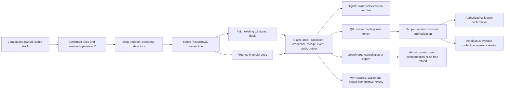

# Independent Shop verification — 19 October 2026

Subsequent isolated end-to-end technical acceptance for F5/F8/F10/F13 is recorded in [Shop redemption acceptance](shop-redemption-acceptance.md). Its passing technical results do not certify the outstanding merchant, provider, physical-device or release gates.

## Initial audit (before new remediation)

Fresh remote baselines: Admin `ad0f33f4105863e9406a01a1644eeb2967b5633a`, Mobile `a0f19d3192c148fa39b1f7fad4901e67826971db`. Production alias resolves to READY deployment `dpl_GakDBgGdBgzDfP78sZv8tdpJQY28`. Read-only PostgreSQL inspection confirms five remediation migrations through 20261019133000, exact 051 function-body matches, gate false and active five-minute scheduler (last observed HTTP 200). Empty production fulfillment queues do not demonstrate recovery execution.

The existing isolated PostgreSQL runner was independently executed: 206 assertions passed, including 12 independent connections. These are synthetic credentials, not proof of real merchant supply or device acceptance.

| Finding | Status | Code evidence | Behavioral evidence | Remaining defect | Required action |
|---|---|---|---|---|---|
| F1 | Partially Resolved | 050 catalog grants/policy; 051 shop_save_catalog | Catalog DML denied, but production reward_partner has RLS off and anon/auth DML true; isolated organisation reassignment reproduced | Partner identity and organisation binding remain rider-writable | Immediate narrow partner-table containment |
| F2 | Fully Resolved | 050 primitive revokes; 051 shop_adjust_points | Fresh effective grants; adjustment/audit/receipt tests | None demonstrated | Preserve controls |
| F3 | Fully Resolved | 050 legacy revokes and command barriers | Effective access denied; historical obligation tests | None demonstrated | Preserve two legitimate records |
| F4 | Fully Resolved | shop_authorize and target lookup in shop_fulfilment_command | Foreign-org cancel/refund/scan/collect/import tests | Actual authenticated deployed partner acceptance remains a release gate | Preserve boundaries |
| F5 | Partially Resolved | shop_prepare/get_credential and Mobile token card | Actual persisted synthetic code/QR retrieval and scan | Real merchant codes, camera/device acceptance not demonstrated | Controlled external acceptance |
| F6 | Fully Resolved | Conditional token update plus receipt in one transaction | 12-connection scan, replay and race tests | None demonstrated | Preserve transaction boundaries |
| F7 | Partially Resolved | Durable resource items/allocations; shop_import_codes | Allocation durability passes; different pools can accept the same organisation's code and expired import replays fail | Resource identity and replay contract incomplete | Scope duplicate protection and preserve committed import receipts |
| F8 | Partially Resolved | shop_unwind and private v2 compensation | Paid/free cancellation, limits, stock and duplicate tests pass; consumed-QR expiry reproduction | Overdue validated QR automatically releases inventory despite ambiguous collection | Retain allocation; expose operator review |
| F9 | Partially Resolved | shop_recover, claim_outbox, worker | 1,005 overdue claims discovered and drained | Unlimited retries; no operator redelivery for completed fulfillment | Bound attempts; durable exception queue and scoped retry |
| F10 | Partially Resolved | shop_catalog and shop_redeem | Unsupported/inactive/exhausted/expired resources rejected; unscoped/mismatched pools and duplicate codes insufficiently constrained | Availability can overstate usable stock | One availability predicate for catalog, allocation and Admin counts |
| F11 | Fully Resolved | Expected price checked before debit; receipt checked first | Stale price rejection and replay pass | Native-device acceptance remains external | Preserve quote authority |
| F12 | Partially Resolved | Central save/approval; expected version | Fulfillment stale command rejected; catalog SoD passes | Catalog expected value optional and server freshly reads current version | Require operator-viewed precondition |
| F13 | Partially Resolved | Atomic transition/audit/outbox | Injected audit/event/receipt failure rolls back | Retry outbox silently updates zero rows on lost lease; unresolved delivery operations | Explicit conflicts and durable operator recovery |

No finding is Deferred or Not Actionable. Both supported fulfillment types remain launch requirements. This baseline table includes additional defects found while repeating the audit against the original revisions; preliminary F1/F8 classifications were downgraded when broader permission/expiry evidence became available. “Fully Resolved” applies to the specific defect with SQL/code and behavioral evidence, not universal production readiness.

### Initial audit addendum: consumed QR expiry

Migration 051 `shop_recover` automatically calls `shop_unwind` for overdue `validated` rewards. This releases reserved inventory and returns paid points even though the token has already been consumed and actual collection may be unconfirmed. The permanent correction must retain the allocation and expose an operator exception until authorized collection/cancellation resolves the ambiguity. This further tracing is reflected in the initial F8 classification above.

## Additional requested control

There is currently no authorized dashboard activation command. The single existing release row is disabled. Extend this authority with audited, versioned enabled/disabled/hold state and durable acceptance evidence. Do not enable production, mutate financial records, or deploy the new operating-state migration without the required authorization. Browsing and existing obligations remain available.

## Remediation implemented

- **F1 P0 containment applied:** `scripts/054a_shop_partner_containment.sql`, migration `20261019135000`. The baseline inspection found `reward_partner` RLS disabled and anonymous/authenticated insert/update/delete granted. Eighteen independent PostgreSQL checks reproduce organisation reassignment only inside a rolled-back local transaction, then deny table/column writes while retaining reads and authorized server management. Production preflight, locked deployment and separate read-only verification preserve all twelve tracked table fingerprints. This includes 18 balances, 34 ledger entries and the two existing redemption obligations. No production exploit, redemption, points change or inventory movement was executed.
- **F7/F10 resource contract:** prepared migration `054_shop_operating_control.sql` serializes code imports per organisation, rejects duplicate identity across its pools, deduplicates existing same-pool codes, and replays a committed import before checking its now-expired quote. `shop_voucher_available` is the common authority for catalog availability, allocation and Admin inventory counts. It withholds expired, malformed or duplicated credentials. Partner catalogs must bind a pool with the same organisation; a validating organisation is required for active QR rewards. Existing products/items remain preserved; unsafe stock is withheld rather than silently fabricated or rewritten.
- **F8 recovery:** overdue consumed QR rewards retain their allocation and points pending operator collection/cancellation review. Unused expired credentials can still unwind automatically. Confirmation removes the review case. Paid compensation, stock restoration, purchase-limit recovery and free cancellation remain in the existing atomic `shop_unwind` transaction.
- **F9/F13 recovery:** discover at most 1,000 previously unqueued candidates per invocation; process bounded batches (worker 50, SQL maximum 100). Both recovery and delivery stop automatic attempts at eight. A paginated exception queue exposes later records and exhausted leases even without a persisted error. Authorized target-scoped operators can queue another bounded cycle, including delivery for completed rewards. Queue revisions increase monotonically, so resetting attempts cannot revalidate stale commands. Lost leases raise conflicts; worker outcome persistence failures propagate. A worker reporting actual recovery/delivery failures returns HTTP 503 rather than a false HTTP 200 success.
- **F12 catalog commands:** SQL requires an expected timestamp on updates. Admin forms, status/feature actions, media actions and partner APIs pass the viewed version. Partner creation requires an explicit numeric price, including zero; missing/blank input cannot silently become Free. Independent activation approval remains enforced. Recovery requests also advance the fulfillment version and record an event. Media uploads use immutable operation-owned keys, preventing a failed catalog precondition from overwriting/deleting another operation's image. Existing approved asset URLs remain readable; no financial compatibility API was added.
- **Account isolation:** Mobile catalog reads now bind the query-key account and abort signal through the existing `readForAccount` boundary. A delayed old query cannot adopt the newly signed-in account or cache its eligibility under the previous account. Both checkout dialogs respond to refreshed operating availability; the server remains the purchase authority.

Exact source authorities are the named functions in `scripts/051_shop_lifecycle.sql`, replacements/new functions in `scripts/054_shop_operating_control.sql`, `features/fulfilment/infrastructure/shopLifecycleApi.ts`, `features/fulfilment/application/commands/runShopRecovery.ts`, `app/actions/rewardCatalog.ts`, and `features/rewards/application/partnerCatalogCommands.ts`. Reproductions and regressions are in Mobile `scripts/test-shop-lifecycle.cjs`, `scripts/fixtures/shop-post-verification.cjs` and `scripts/test-shop-partner-containment.cjs`.

## Canonical lifecycle and guarantees

The wallet advisory lock precedes the shared operating-state lock and catalog/resource locks. Disabling/holding takes the exclusive operating-state lock: an already executing claim commits atomically before the state change; subsequent new purchases fail closed. A committed operation still replays while disabled. Fulfillment, credential retrieval, refunds and recovery do not depend on new purchases being enabled.

Paid claims produce exactly one signed debit and a linked redemption. Free claims—including riders without a balance row—produce no debit, credit, refund or zero-value ledger entry. Both use the same RPC, inventory locks, limits, receipts and fulfillment contracts. Cancellation restores only inventory actually debited and restores eligibility exactly once. A disclosed digital voucher is not automatically restocked/refunded; external revocation cannot be assumed. QR validation consumes the token atomically; collection is a separate explicit confirmation. Merchant staff must confirm collection before treating the journey as fulfilled.

No second wallet, competing fulfillment state machine, fake provider or process-memory allocation authority was introduced. Original unsafe mutation RPCs remain effectively retired, including service-role execution. The only historical obligation command remains the narrow authorized reservation cancellation; retire it after the two genuine obligations are resolved. Existing immutable migrations, financial history and owner reads remain intact. Allowed trigger-returning routines cannot be directly invoked as financial RPCs; the inspected historical reconciliation function is read-only SECURITY INVOKER, not an alternate credit writer.

## Dashboard operating control

After the approved rollout, use **Rewards → Catalog → Public Shop redemption**. Security administrators can reach the same control directly from Rewards without acquiring catalog mutation or wallet access. Existing `settings.security` capability and SQL checks restrict control to `super_admin`/`security_admin`; ordinary staff, partner managers and riders cannot change it.

The original release row becomes the single persistent `state` authority: `enabled`, `disabled`, `hold`. The old boolean is a generated projection required by the actual deployed catalog consumer, not an independently writable switch. The obsolete `rewardsShopEnabled` configuration and Mobile visibility gate are removed from source. All new free/paid claims enforce the state in SQL. Shop browsing and My Rewards remain accessible, with an existing-style paused notice and fresh account-scoped catalog reads.

Every operating change requires the viewed version, operation identity and reason. It records previous/new state, actor and timestamp atomically with its receipt. A stale dashboard conflicts; a lost response can replay its original operation. A hold cannot transition directly to Enabled. Revoking readiness creates an audited hold.

Enablement checks durable, attributed acceptance records for F1–F13, digital/QR operation, supply, integration, native device, provider and web-consumer acceptance. Each record identifies its report/reference, full verified revision, reviewer and validity (maximum 30 days). These are explicit security-administrator attestations to verifiable reports, **not automatic certification of merchant codes, devices or undiscovered vulnerabilities**. They must be revoked when the verified release/conditions change. Enablement additionally checks reconciliation, actual usable stock for both launch types, recovery failures, overdue work, scheduler status and a recent successfully persisted worker outcome. Expired/revoked evidence blocks new claims even if a client cached Enabled. No acceptance evidence is seeded in production and deployment never enables redemption.

All new UI uses existing MOVRR Card, Button, Badge, Select, Dialog, Input, Textarea, skeleton and semantic tokens. Existing screen structures, tables, typography, geometry and navigation remain. Changes are operational controls, existing-action preconditions, accurate Free/paused states and inventory/exception information. No cross-platform visual parity is claimed from source or bundle tests alone.

## Verification and limitations

Two full isolated lifecycle passes run against the actual SQL: an upgrade from 051 and a complete rerun with the new operating/resource contracts installed before the original suite. Applied SQL hashes—not a later filesystem snapshot—are recorded in `docs/verification/shop-independent/`. The full pass rechecks original grants/entry points, prices, paid/free settlement, 12-connection debit/scan races, owner delivery, release/consume races, refunds/limits, inventory, stale approval commands, audit failures, expiry and reconciliation. It discovers/drains 1,005 interrupted cases across bounded discovery batches and exercises exception pagination beyond the first 50.

Additional cases cover anonymous partner reassignment containment, failed readiness/financial/worker checks, controller-role denial, concurrent state changes, stale versions, lost-response replay, hold revocation, in-flight disable, fulfillment/refund while disabled, eight-attempt exhaustion, lease conflict, monotonic queue revisions, duplicate imports, expired import replay, mismatched resource ownership and withholding duplicate credentials. The actual application worker runs against isolated PostgreSQL; its external email provider is explicitly doubled, with stable identity and no repeated financial effect. Audit/event/receipt fault injection rolls transactions back. A child application is killed before commit; a new connection replays after commit. These are not claims of physical-device termination or real merchant/provider acceptance.

Existing wallet suite: 86 real PostgreSQL assertions. Original containment: 14 isolated checks. New partner containment: 18 PostgreSQL checks. Scheduler/private transport: 20 + 14 isolated checks with transport doubled. Admin/Mobile TypeScript, lint, tests and local builds/exports are recorded separately in `source-checks.json`. Four existing Mobile lint warnings remain in Campaigns/Searchbar. Test diagnostic fixtures deliberately log contract/search warnings; they do not indicate a production mutation. A new cache test initially depended on immediate garbage collection; its fixture now deliberately retains and settles the old-account query, with focused open-handle verification.

Production verification is read-only apart from the explicitly authorized narrow P0 partner-policy containment and the subsequently approved operating-control migration/backend rollout. It includes effective table/column privileges, routine bodies, RLS policies, migration versions, fingerprints and two real owner-history probes using aggregate results only. The baseline deployed Admin is READY `ca8d226f6af71509a079707c94129afb6082ddcd`, deployment `dpl_GakDBgGdBgzDfP78sZv8tdpJQY28`, project `prj_VdWMMAnBPo7u5G9RPmlA6t9hMgCT`. Its difference from original remote `ad0f33f` was documentation/evidence only. Supabase target and service/email/recovery binding metadata were freshly checked without exporting secret values. Binding presence and an empty scheduled HTTP 200 do not demonstrate inbox delivery or processing real queued rewards.

## Final F1–F13 audit matrix

Final independent results: **310** isolated upgrade assertions and **305** full operating-baseline assertions, with the same applied SQL hash `4665141c56f912cc9fda836b04e61507b658a08ce8adee2834d4ff5ca7d88d03`. These are two passes with overlapping coverage, not 615 distinct cases. Admin: **54 suites / 605 tests**, TypeScript/lint and local production build pass. Mobile: **33 suites / 366 tests**, TypeScript and lint pass with the four existing warnings; local native exports and the focused account-cache open-handle check are recorded in the source evidence. Production wallet/ledger privacy probes covered **18** real owners with zero anonymous/cross-rider financial rows, and live reconciliation reported zero mismatches/unpaired paid claims/free financial entries. The two historical reservations remain preserved. SQL/production evidence is in Mobile `docs/verification/shop-independent/` and `docs/verification/shop-partner/`; source check summaries are in Admin `docs/verification/shop-independent/source-checks.json`.

The status below considers **actual deployed production**, not only source/isolated test completion. A prepared, tested correction remains partial until its required rollout/acceptance evidence exists.

| Finding | Final status | Implementation and behavioral evidence | Remaining gate |
|---|---|---|---|
| F1 | Fully Resolved | Catalog denial plus new partner RLS/table/column containment; 18 isolated checks; production effective permissions and unchanged fingerprints | Preserve controls |
| F2 | Fully Resolved | Financial primitives client/service execution denied; authorized signed adjustment, receipt and audit rollback checks; actual v2 bodies inspected | Preserve controls |
| F3 | Fully Resolved | Legacy mutation execution denied; canonical barriers; two owner history probes; legitimate historical cancellation regression | Preserve narrow historical reads/obligations |
| F4 | Fully Resolved | Actual target organisation checked in command SQL; independent cross-org cancel/refund/consume/collect/import denial | Authenticated merchant/device acceptance still required for launch |
| F5 | Partially Resolved | Actual persisted synthetic digital/QR credentials retrieved, reopened and consumed through canonical contracts | Real merchant supply, camera/device and deployed owner/partner journeys |
| F6 | Fully Resolved | Single SQL consume/validation/receipt transaction; 12 independent connections, replay and release/consume race | Preserve transaction boundary |
| F7 | Fully Resolved | Durable allocations; concurrent duplicate protection and expired receipt replay demonstrated against real isolated PostgreSQL; exact tested migration applied and matching Admin deployed | Real merchant/device acceptance remains a launch gate |
| F8 | Partially Resolved | Atomic paid/free unwind and consumed-overdue QR policy verified in isolated SQL; corrected policy deployed | Merchant operational acceptance |
| F9 | Fully Resolved | Bounded discovery/attempts, pagination, interruption/replay and real worker/SQL recovery verified locally; corrected worker/schema deployed; five-minute scheduler persisted a successful heartbeat at 13:05:02 UTC | Empty production queue confirms execution, not real voucher/provider delivery |
| F10 | Partially Resolved | Shared supported-type/owned-resource/usable-code predicate verified in isolation and deployed | Verify actual launch inventory; production inventory readiness is false |
| F11 | Fully Resolved | Confirmed expected price checked before new debit; same operation replays original charge; changed quotes reject and require reconfirmation | Native/deployed consumer acceptance remains a release gate |
| F12 | Fully Resolved | Required catalog/operator versions, partner schema, independent approval, immutable media and queue revision checks verified; exact SQL and matching Admin entry points deployed | Authenticated deployed controller/partner acceptance remains a launch gate |
| F13 | Partially Resolved | Atomic state/event/audit/outbox, lost-lease errors and worker outcomes verified in isolation; corrected persistence/worker deployed | Actual provider delivery acceptance |

No finding is Deferred or Not Actionable. There are no claimed production fixes based solely on mocked tests. The remaining partial statuses are explicit release blockers.

## Deployment and activation gates

Applied production migrations: `20261019110000`, `20261019122000`, `20261019123000`, `20261019131500`, `20261019133000`, new P0 `20261019135000`, and approved operating control `20261019140000`. Public redemption remains disabled; financial/catalog/inventory records are unchanged by containment.

Approved rollout completed on 19 October 2026: **`20261019140000` / `054_shop_operating_control.sql`** applied to `kzdvunpuxaxlphqvmzxw`; normalized SQL SHA-256 `4665141c56f912cc9fda836b04e61507b658a08ce8adee2834d4ff5ca7d88d03`. All 12 tracked financial/catalog/inventory table fingerprints remained unchanged. Admin runtime **`22f7cf501c68af3919e91c48679e0b28f4f76df9`**, deployment `dpl_FkyszEXAdmZ9iz31pUvmBWrbnx3D`, is READY at `admin.movrr.nl`. Twelve live unauthenticated boundary probes returned application JSON 401. State remains **Disabled**, version 0, with zero fabricated readiness records; activation is blocked by all 20 missing evidence criteria and unavailable launch inventory. Rollout evidence is in Mobile `docs/verification/shop-operating/` and Admin `docs/verification/shop-independent/deployment-rollout.json`. Historical deployment-baseline evidence is intentionally retained. The existing scheduler dispatched at 13:05:00 UTC and the new worker persisted its heartbeat at 13:05:02 UTC, with zero failures, zero notification failures and no queued work. This confirms live execution while Disabled, without manufacturing production claims; actual queued-work recovery was exercised only in isolated PostgreSQL. Reproduce the read-only operating checks with Mobile `node scripts/verify-shop-operating-production.cjs --require-worker`.

Complete the safe integration/native camera/offline/restart/provider journeys with actual authorized merchant test credentials. Verify supply/terms/limits, independent catalog approvals and validate-versus-collect procedures. Resolve or retire the separate `movrr-app` web checkout before recording its acceptance. Mobile source still needs its separately authorized release; no EAS build, OTA or store action was performed. Only then may a security controller record genuine acceptance evidence and explicitly enable public redemption.

**Decision: public redemption is not ready for activation.** P0 containment is active; remaining source corrections are implemented and isolated-tested, and the approved operating rollout is complete; external acceptance is not implied by green tests. Source implementation and final remote revisions are recorded with the delivery evidence/final response; they must not be mistaken for the currently deployed runtime.
